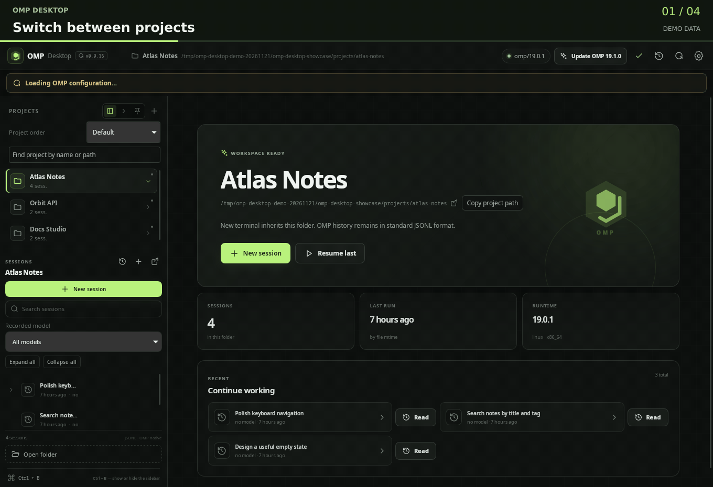

# OMP Desktop

**Проекты, история и терминалы Oh My Pi — в одном настольном приложении.**

An independent desktop workspace for [Oh My Pi](https://github.com/can1357/oh-my-pi) on Windows and Linux.

[](https://github.com/Omnividente/omp-desktop/releases/latest)
[](LICENSE)


**[Русский](#русский) · [English](#english)**

[Скачать / Download](https://github.com/Omnividente/omp-desktop/releases/latest) · [Все выпуски / All releases](https://github.com/Omnividente/omp-desktop/releases) · [Обсуждения / Discussions](https://github.com/Omnividente/omp-desktop/discussions)



*Реальный интерфейс приложения с вымышленными проектами и подготовленной историей. / Actual application UI with fictional projects and prepared session history. [О записи / Recording details](docs/media/README.md) · [Статичный кадр / Still image](docs/media/omp-desktop-demo.png).*

## Русский

**OMP Desktop** — независимый графический клиент для **Oh My Pi**. Он помогает держать проекты и сессии под рукой, продолжать работу в нескольких терминалах и читать сохранённые ответы с форматированием Markdown.

Живая работа с агентом проходит в привычном терминальном интерфейсе OMP. Desktop добавляет управление рабочими папками, поиск истории, настройки и диагностику. **OMP устанавливается отдельно**; приложение не включает модель, подписку провайдера или API-ключи.

### Что можно делать

| Задача | Возможности Desktop |
| --- | --- |
| Вернуться к работе | Проекты и недавние сессии, поиск, возобновление и просмотр цепочек продолжения (handoff). |
| Работать параллельно | Несколько вкладок с нативными PTY-терминалами, поиск открытых вкладок и переключение между ними. |
| Читать и находить ответы | Отдельный просмотр сохранённого диалога, Markdown, таблицы и код, поиск по загруженной истории и копирование. |
| Перенести историю | Импорт JSONL из OMP и Codex, копирование сохранённой сессии в другой проект. |
| Настроить OMP | Каталог моделей, роли и доступные определения агентов, провайдеры и сведения о лимитах, которые сообщает установленный runtime. |
| Настроить рабочее место | Русский, английский и упрощённый китайский; тёмная, светлая и системная темы, отдельные размеры текста интерфейса и терминала. |
| Разобраться с проблемой | Монитор памяти и диска, состояние процессов OMP и центр runtime-инцидентов. |

Кнопка **«Читать»** открывает сохранённую историю без запуска новой сессии и без запроса к модели. Завершённые ответы также можно раскрывать над работающим терминалом. Подробности и ограничения: [справочник возможностей](docs/FEATURES.ru.md).

README описывает текущие исходники. Набор возможностей установленной версии сверяйте с [описанием её выпуска](https://github.com/Omnividente/omp-desktop/releases).

### Установка

1. [Установите и настройте Oh My Pi](https://github.com/can1357/oh-my-pi#install) для своего пользователя ОС. Проверьте, что команда `omp --version` работает в обычном терминале.
2. Откройте [последний стабильный выпуск OMP Desktop](https://github.com/Omnividente/omp-desktop/releases/latest).
3. Скачайте пакет для своей системы. Готовые сборки предназначены для **x86-64**.

| Система | Пакеты |
| --- | --- |
| Windows x64 | Установщик `.exe` (NSIS) или `.msi`. |
| Linux x86-64 | `.AppImage`, `.deb` или `.rpm`. |

AppImage:

```bash
chmod +x OMP.Desktop_*.AppImage
./OMP.Desktop_*.AppImage
```

Debian / Ubuntu:

```bash
sudo apt install ./OMP.Desktop_*_amd64.deb
```

Fedora / совместимые RPM-системы:

```bash
sudo dnf install ./OMP.Desktop-*.x86_64.rpm
```

В openSUSE используйте `sudo zypper install ./OMP.Desktop-*.x86_64.rpm`.

### Первые шаги

1. Откройте Desktop и выберите папку проекта через **«Открыть папку»**.
2. Если OMP не найден, откройте **«Настройки → Основное»**, укажите путь к установленному исполняемому файлу OMP и сохраните настройку.
3. Создайте **новую сессию**, продолжите существующую или нажмите **«Читать»**, чтобы посмотреть её историю.
4. При необходимости выберите модели и провайдеров в настройках. Их доступность и возможности зависят от установленного OMP и подключённых учётных данных.

### Обновления

По умолчанию Desktop предлагает стабильные выпуски. Нажмите на номер версии приложения, чтобы проверить обновления вручную.

Для тестирования предварительных выпусков включите **«Настройки → Основное → Предлагать предварительные версии»** и сохраните настройку. Установка требует подтверждения; выключение этой опции не откатывает уже установленную версию. Все предварительные выпуски доступны в [списке релизов](https://github.com/Omnividente/omp-desktop/releases).

### Данные и провайдеры

- Проекты, настройки и история находятся на вашем компьютере. При работе OMP может отправлять запросы и контекст настроенным провайдерам; локальный интерфейс не означает офлайн-работу модели.
- Ключи, добавленные через Desktop, используют системное хранилище учётных данных. Если оно недоступно, приложение предупреждает о резервном локальном файле с ограниченными правами; этот файл не зашифрован.
- Просмотр и импорт истории не удаляют секреты из исходного JSONL. Перед публикацией логов, сессий или снимков проверяйте их содержимое.
- Доступ по API и потребительская подписка могут иметь разные условия и оплату. Проверяйте правила выбранного провайдера перед подключением.

[Подробнее о приватности и условиях доступа](docs/PRIVACY.md#русский).

### Помощь и участие

[Сообщить об ошибке или предложить улучшение](https://github.com/Omnividente/omp-desktop/issues) · [Задать вопрос](https://github.com/Omnividente/omp-desktop/discussions) · [Внести вклад](CONTRIBUTING.md)

В сообщении об ошибке укажите версии Desktop и OMP, ОС и шаги воспроизведения. Об уязвимостях сообщайте [приватно](SECURITY.md).

OMP Desktop — самостоятельный open-source проект, который не входит в официальную поставку Oh My Pi. Вопросы об интерфейсе Desktop обсуждаются в этом репозитории; [обсуждение интеграции с OMP](https://github.com/can1357/oh-my-pi/issues/12456) не означает одобрения проекта upstream.

## English

**OMP Desktop** is an independent graphical client for **Oh My Pi**. Keep projects and sessions within reach, continue work across terminal tabs, and read saved answers with Markdown formatting.

Live agent work uses OMP's familiar terminal interface. Desktop adds workspace navigation, searchable history, settings, and diagnostics. **Install OMP separately**; Desktop does not include a model, provider subscription, or API keys.

### What you can do

| Task | Desktop features |
| --- | --- |
| Pick up your work | Projects and recent sessions, search, resume, and handoff lineage. |
| Work in parallel | Multiple native PTY terminal tabs, open-tab search, and quick switching. |
| Read and find answers | A saved-dialogue reader with Markdown, tables, code, search across loaded history, and copy actions. |
| Bring your history | Import OMP and Codex JSONL, or copy a saved session into another project. |
| Configure OMP | Model catalog, roles and available agent definitions, providers, and usage information reported by the installed runtime. |
| Make it comfortable | Russian, English, and Simplified Chinese; dark, light, and system themes; separate interface and terminal text sizes. |
| Investigate problems | Memory and disk monitoring, OMP process information, and a runtime incident center. |

**Read** opens saved history without starting a new session or sending a model request. Completed answers can also be expanded above a running terminal. See the [behavior reference](docs/FEATURES.md) for details and limits.

This README describes the current source tree. Check an installed version against its [release notes](https://github.com/Omnividente/omp-desktop/releases).

### Installation

1. [Install and configure Oh My Pi](https://github.com/can1357/oh-my-pi#install) for your OS user. Confirm that `omp --version` works in a regular terminal.
2. Open the [latest stable OMP Desktop release](https://github.com/Omnividente/omp-desktop/releases/latest).
3. Download a package for your system. Prebuilt packages target **x86-64**.

| System | Packages |
| --- | --- |
| Windows x64 | `.exe` installer (NSIS) or `.msi`. |
| Linux x86-64 | `.AppImage`, `.deb`, or `.rpm`. |

AppImage:

```bash
chmod +x OMP.Desktop_*.AppImage
./OMP.Desktop_*.AppImage
```

Debian / Ubuntu:

```bash
sudo apt install ./OMP.Desktop_*_amd64.deb
```

Fedora / compatible RPM systems:

```bash
sudo dnf install ./OMP.Desktop-*.x86_64.rpm
```

On openSUSE, use `sudo zypper install ./OMP.Desktop-*.x86_64.rpm`.

### First steps

1. Launch Desktop and select a project with **Open folder**.
2. If OMP is not detected, open **Settings → General**, set the path to your installed OMP executable, and save.
3. Start a **new session**, resume an existing one, or choose **Read** to browse its history.
4. Choose models and providers in Settings when needed. Availability and capabilities depend on the installed OMP runtime and configured credentials.

### Updates

Desktop offers stable releases by default. Click the application version to check manually.

To test prereleases, enable **Settings → General → Offer prerelease versions** and save. Installation requires confirmation; disabling this option does not downgrade an installed version. Browse all candidates on the [releases page](https://github.com/Omnividente/omp-desktop/releases).

### Data and providers

- Projects, preferences, and history are stored on your computer. OMP may send prompts and context to configured providers; a local interface does not mean offline inference.
- Keys added through Desktop use the OS credential store. If it is unavailable, Desktop warns and uses a local fallback file with restricted permissions; that file is not encrypted.
- Reading or importing history does not remove secrets from the original JSONL. Inspect logs, sessions, and screenshots before sharing them.
- API access and consumer subscriptions may have different terms and billing. Check the provider's rules before connecting.

[More about privacy and provider access](docs/PRIVACY.md#english).

### Help and contributions

[Report a bug or request a feature](https://github.com/Omnividente/omp-desktop/issues) · [Ask a question](https://github.com/Omnividente/omp-desktop/discussions) · [Contribute](CONTRIBUTING.md)

Include Desktop and OMP versions, your OS, and reproduction steps in bug reports. Report vulnerabilities [privately](SECURITY.md).

OMP Desktop is an independent open-source project, separate from the official Oh My Pi distribution. Desktop support belongs in this repository; the [upstream integration discussion](https://github.com/can1357/oh-my-pi/issues/12456) does not imply endorsement.

## Development

Built with **Tauri 2, Rust, React, TypeScript, and xterm.js**. Requirements: Node.js 22.13.0+ on the 22.x line (or 24+), Rust 1.95+, and the [Tauri platform prerequisites](https://v2.tauri.app/start/prerequisites/). Install OMP to exercise live sessions.

```bash
npm ci
npm run tauri dev
```

The React interface lives in `src/`; the native backend, PTY lifecycle, session discovery, and local settings live in `src-tauri/`.

[Development setup and checks](CONTRIBUTING.md) · [Release preparation and acceptance](docs/RELEASES.md) · [Proposal register](docs/PROPOSALS.md) · [Integration decisions](https://github.com/Omnividente/omp-desktop/issues/177)

## License

OMP Desktop is licensed under the [MIT License](LICENSE).
