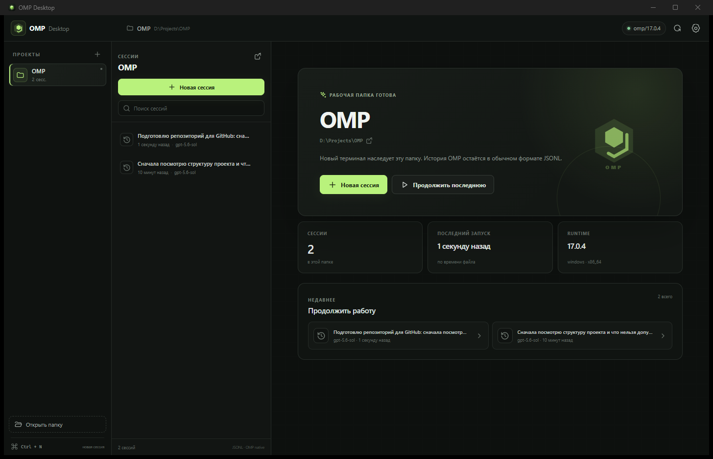

# OMP Desktop

[](https://github.com/Omnividente/omp-desktop/releases/latest)
[](LICENSE)


Independent desktop workspace for [Oh My Pi](https://github.com/can1357/oh-my-pi) — projects, sessions, and OMP terminals on Windows and Linux.

**[Русский](#русский) · [English](#english)**

## Русский

**OMP Desktop** — независимый open-source графический клиент для [Oh My Pi](https://github.com/can1357/oh-my-pi). Он объединяет управление проектами и сессиями, историю переписки и живые OMP-терминалы в одном нативном приложении для Windows и Linux.

Для тех, кому нужен графический доступ к проектам и настройкам с сохранением привычного OMP: живая беседа идёт через встроенный терминальный интерфейс OMP (TUI), а не отдельный графический чат. Это локальное настольное приложение, не веб-клиент или размещённый в облаке сервис; OMP устанавливается отдельно.

**[Установка](#установка) · [Последний стабильный релиз](https://github.com/Omnividente/omp-desktop/releases/latest)**



> **Независимый клиент:** проект не входит в официальную поставку OMP. Поддержка Desktop ведётся в этом репозитории; публикация в upstream не означает одобрения со стороны OMP. [Обсуждение интеграции →](https://github.com/can1357/oh-my-pi/issues/12456)

### Основные возможности

- **Проекты и сессии:** рабочие папки, поиск, возобновление и цепочки handoff.
- **Нативные PTY-терминалы:** параллельные вкладки, изменение размера, прерывание и завершение процессов; новый вывод остаётся внизу, пока пользователь не просматривает историю, а стрелка возвращает к последним сообщениям.
- **Конфигурация и провайдеры:** настройки OMP, модели, аккаунты, лимиты и фиксация провайдера для сессии.
- **История и диагностика:** импорт OMP/Codex JSONL, просмотр и поиск переписки, предупреждения и монитор ресурсов.
- **Windows и Linux:** единая кодовая база, установочные пакеты и обновления с подтверждением при работающих терминалах.

> Подробное поведение ниже описывает ветку `main`, которая может опережать стабильную сборку. Для установленной версии используйте [описание соответствующего релиза](https://github.com/Omnividente/omp-desktop/releases). Изменения этого выпуска перечислены в [v0.9.7](.github/release-notes/v0.9.7.md).

<details>
<summary>Подробные возможности, ограничения и поведение</summary>

- Проекты и недавние рабочие папки в боковой панели.
- Последний выбранный проект восстанавливается после перезапуска Desktop; явный `--project` имеет приоритет. Удалённые или скрытые папки не возвращаются автоматически, терминалы без запроса не запускаются.
- Перекрывающиеся переименования, добавления и удаления проектов сохраняют все успешные изменения; завершение фоновой операции или импорта не отменяет более новый выбор проекта.
- Автоматическое обнаружение стандартных JSONL-сессий OMP. Нечитаемые файлы и нераспознаваемые заголовки показываются отдельным предупреждением с путями и повторным чтением; остальные сессии остаются доступны.
- Сводки для боковой панели используют ограниченные фрагменты начала и конца JSONL, а не всю историю. После определения наличия диалога и резервного заголовка содержимое последующих сообщений и tool results не разворачивается в JSON-деревья; события заголовка, модели и thinking в прочитанных фрагментах продолжают обновлять сводку. Вложенные JSONL в одноимённых каталогах артефактов не добавляются как отдельные сессии.
- Наблюдатель runtime при возобновлении читает не более 2 MiB начала и 2 MiB конца JSONL, плюс байты границы и контрольного якоря, без выдачи исторических событий. Новые дописывания читаются полностью; незавершённая строка сохраняется до завершения и выдаётся один раз. Текущий заголовок в начале файла имеет приоритет над старым заголовком в хвосте.
- Полный проход для восстановления защиты от повторов отложен до замены файла: сохранённый дескриптор исходного файла проверяется и читается только до первоначального EOF. Если исходный снимок больше недоступен, используется однозначная известная граница в хвосте; без неё неоднозначная история становится новым baseline, а последующие дописывания продолжают поступать. Desktop не переписывает и не удаляет историю ради этой оптимизации.
- Поиск, открытие и возобновление существующих сессий. Очистка поиска оставляет фокус в поле ввода.
- Новая терминальная вкладка запускает обычную сессию OMP в папке проекта, заданной Desktop; OMP создаёт JSONL при первом ответе. Модель и уровень рассуждений можно переключать до первого ответа через штатные элементы управления OMP, без перезапуска процесса и потери черновика. Desktop подхватывает runtime-запись после создания файла, не отправляя служебный запрос модели. Позднее обновление от старой терминальной вкладки не сбрасывает более новый выбор сессии пользователем или событием другой вкладки.
- Handoff-переходы отслеживаются без перезапуска: текущая сессия остаётся в корне раскрываемой группы, архивные предшественники вложены под ней, а поиск сохраняет полную цепочку. Глубокие цепочки обрабатываются итеративно, без рекурсивных обходов.
- Фиксация основного провайдера хранится для конкретной сессии: переключение в состоянии idle перезапускает её через точный `--session` с локальным overlay без model/usage fallback и переносится на активное продолжение после handoff. После перезапуска фокус возвращается на переключатель, если пользователь не выбрал другой элемент; подключение нового терминала этот выбор не перехватывает.
- Desktop Proxy Mode включается отдельно для каждого провайдера в настройках: новые и перезапущенные сессии получают локальный overlay, который удерживает fallback внутри выбранного провайдера, не переопределяя транспорт OpenAI Codex. Выбор WebSocket или SSE остаётся за настройками OMP и возможностями модели/провайдера. Старое принудительное `openaiWebsockets: off` удаляется из сгенерированного overlay при следующем запуске или перезапуске терминала; уже работающие сессии не изменяются.
- Экран «Провайдеры» показывает отдельные аккаунты из `omp usage`, лимиты по семействам моделей, окна и время сброса, отключённые credentials и оценку доступности маршрутов. Здесь же можно временно отключать любые провайдеры через `disabledProviders`, удалять custom providers и добавлять OpenAI- или Anthropic-совместимые API с автоматическим `/models` discovery. Форматы Chat Completions, Responses API и Anthropic Messages снабжены пояснениями; новые Provider IDs нормализуются в нижний регистр. Идентификаторы аккаунтов маскируются в backend; API keys используют защищённое хранилище Desktop, не записываются в `models.yml` и не возвращаются в снимках настроек.
- Каталог моделей обновляется через `omp models refresh --json` при загрузке конфигурации Desktop: успешное discovery повторяется не чаще раза в 10 минут, ошибка команды — не чаще раза в 30 секунд. «Обновить модели и статус» принудительно обновляет discovery и usage с отдельным 30-секундным cooldown; доступный кэш сохраняется при ошибке refresh. Обновление не стирает несохранённые настройки и передаёт новый каталог в селектор сессии без Save. Уровни thinking берутся только из каталога OMP: Desktop не выдумывает capabilities, которых runtime не сообщил, и не может восстановить ошибки провайдера, скрытые успешным ответом CLI.
- «Настройки» повторно используют загруженный снимок OMP до 10 минут для того же runtime; одновременные загрузки главного окна и настроек разделяют один запрос. После истечения этого срока, смены runtime или сохранения без возвращённого снимка выполняется новый опрос; ручное обновление сохраняется. При сохранении передаются только изменённые роли, а остальные назначения сохраняются из свежей конфигурации OMP, не из устаревшего снимка окна. Пустой selector снимает назначение только указанной роли.
- «Настройки → Модели» разделены на основные роли (`default`, `smol`, `slow`, `plan`), цепочки резервов и вспомогательные роли. Показаны 15 встроенных ролей актуального OMP и пользовательские роли из `modelRoles`, `cycleOrder` и `modelTags`, включая ещё не назначенные. Каталог включает типы моделей; чатовые сессии предлагают только chat-модели, а image/tts/stt и другие типы доступны в соответствующих ролях. Для `web` CLI не сообщает capability поиска, поэтому окончательную совместимость проверяет OMP.
- Подраздел агентов показывает реальные `reviewer`, `security-reviewer` и другие доступные определения: источник, модели из определения, доступность для делегирования и отдельное назначение модели. Это типы агентов, не `modelRoles`: изменения сохраняются в `task.disabledAgents` и `task.agentModelOverrides`. Очистка назначения возвращает наследование определения; упорядоченные selector-массивы не преобразуются при обычном Save. Включение разрешает делегирование, но не запускает reviewer после каждого ответа. Сохраняются только изменённые поля с проверкой baseline; изменения другого агента остаются, конфликт того же агента требует перечитать настройки.
- Каталог агентов охватывает встроенные определения через публичный `agents unpack`, пользовательский каталог OMP, ближайший `.omp/agents` последнего рабочего каталога Desktop и доступные абсолютные `extensions` roots. Относительные расширения, installed/marketplace plugins и временные session-local определения не перечисляются исчерпывающе; это ограничение объясняется справкой в разделе агентов, а не предупреждением о состоянии OMP. Реальные ошибки чтения каталога остаются предупреждениями. Запись `configured` содержит сохранённые настройки без известного определения, а наследуемую модель окончательно выбирает runtime в рабочей папке сессии. Обновление каталога добавляет найденные строки, не стирая черновики.
- Идемпотентный импорт OMP и Codex JSONL с режимами «пропустить», «обновить» и «создать копию»: JSONL ограничен 256 MiB, связанные артефакты копируются транзакционно без ссылок и ограничены 512 MiB, 10 000 записей и глубиной 16 каталогов. При частичном результате импорта Codex успешные элементы снимаются с выбора, чтобы повтор затронул только неудачные. Прерванное обновление JSONL и артефактов восстанавливается при следующем чтении списка сессий. Большой список Codex отображает только видимые строки, не ограничивая выбор сессий.
- Большие транскрипты читаются ограниченно: интерфейс показывает начало и последние записи и явно отмечает пропущенную середину. Повреждённые записи в прочитанной части и незавершённая последняя строка отмечаются отдельно; чтение не изменяет исходный файл.
- После завершения ответа над терминалом автоматически появляется панель с Markdown, таблицами и блоками кода: можно скопировать отдельный блок, весь видимый текст или исходный Markdown, перейти к предыдущему ответу и свернуть панель. Во время нового запроса виден полный терминал; процесс, поле ввода и черновик не заменяются. Панель читает сохранённые ответы текущей сессии из JSONL, без разбора терминального вывода и без показа tool calls, рассуждений и прерванных ответов. После перезапуска Desktop ответы снова доступны при возобновлении сессии.
- Чтение завершённых ответов проверяет JSON, но не создаёт JSON-деревья для пользовательских сообщений, tool results и служебных записей. Несвязанные обновления окна не перерисовывают Markdown неизменённого ответа; переключение вкладок сохраняет выбранный ответ, свёрнутое состояние и позицию прокрутки панели.
- Кнопка «Читать» над текущим терминалом открывает последние сохранённые сообщения в режиме «Только диалог», не останавливая OMP и не меняя набранный черновик. Это снимок JSONL: новые записи появляются после «Перечитать файл», без отправки запроса модели.
- Переписка отображает Markdown: заголовки, списки, цитаты, таблицы и отдельные блоки кода. «Копировать блок» сохраняет его текст, отступы и пустые строки без ограждений; у сообщения есть копирование видимого текста и исходного Markdown. Доступны исходный вид и переход к последнему сообщению. HTML остаётся текстом, внешние изображения не загружаются автоматически, ссылки используют защищённые действия Desktop.
- Поиск в просмотре переписки проходит по всему загруженному видимому тексту выбранного режима, а не только по строкам на экране: `Ctrl+F`, счётчик отдельных совпадений, переходы вперёд/назад и подсветка, включая текст через Markdown-разметку и подписи ссылок. Запрос ищется буквально, без учёта регистра Unicode; число совпадений и навигация не ограничиваются. Компактный индекс хранит смещения UTF-16. Для каждой смонтированной записи создаётся окно до 512 диапазонов подсветки, вокруг текущего совпадения в выбранной записи; в DOM одной записи — не более 512 элементов `mark`, включая части совпадений через Markdown-узлы. Подсветка текущего совпадения сохраняется, а полный текст и копирование не усекаются. `Escape` очищает непустой запрос без закрытия окна; при пустом запросе закрывает просмотр. Пропущенная при ограниченном чтении середина файла в поиск не входит.
- Просмотр переписки из боковой панели запоминает сообщение и смещение при повторном открытии в текущем запуске Desktop; позиции разных сессий независимы и не записываются в JSONL. Перечитывание файла сохраняет место, а переключение исходного и форматированного вида удерживает текущее сообщение. `Tab` переводит фокус на область переписки, где работают стрелки, `PageUp` / `PageDown`, `Home` и `End`.
- Изменение ширины окна сохраняет видимое сообщение и смещение внутри него; если сообщение стало короче, смещение ограничивается его новой высотой. Обе кнопки очистки поиска возвращают фокус в поле поиска, а переход к последнему сообщению показывает конец даже очень высокого сообщения и не перехватывает фокус.
- Несколько одновременно работающих терминальных вкладок.
- После закрытия последней терминальной вкладки потерянный фокус возвращается на «Новая сессия» домашнего экрана, без выбранного проекта — на «Открыть папку», а при недоступном запуске — на другое доступное действие. Переход происходит только если фокус принадлежал удалённому интерфейсу; отмена закрытия и новый фокус вне него не перехватываются. Изначально пустой экран не получает автофокус.
- Настоящий нативный PTY с изменением размера, прерыванием и корректным завершением процессов. Перерасчёт размера после изменения шрифта или вкладки сохраняет синхронизацию терминала с PTY и восстанавливает фокус после ошибки подгонки. Подгонка активного терминала после изменения компоновки или видимости перерисовывает весь viewport даже при прежнем числе строк и столбцов; периодической перерисовки нет, буфер и процесс не пересоздаются.
- Курсор остаётся видимым, но не мигает на Windows и Linux: терминал не запускает непрерывную idle-анимацию. Новый дисплей того же PTY получает полный сохранённый replay; повторная доставка уже отображённых пакетов не дублирует вывод.
- На Windows Desktop сохраняет legacy VT-ввод ConPTY: изолированный вспомогательный процесс отключает Win32 input mode `9001` перед каждой передачей ввода, в том числе после его повторного включения runtime. Стрелки, `Delete` и перемещение курсора мышью не превращаются в отдельный `Escape` и печатные ANSI-хвосты. Байты пользовательского ввода не переписываются; файлы OMP не изменяются. При закрытии PTY вспомогательный процесс завершается.
- На Linux активный видимый терминал пытается включить WebGL2-рендерер xterm; при недоступности или потере контекста тот же терминал переходит на штатный DOM-рендерер, сохраняя PTY, буфер, ввод и выделение. Неактивная или скрытая вкладка освобождает WebGL-контекст. Повторная попытка возможна после изменения размеров, шрифта, масштаба экрана или скрытия/возврата вкладки, но не из-за нового вывода. Мигание курсора и анимация плавной прокрутки отключены. Живой вывод объединяется в окна по 50 мс, без пропуска байтов и перестановки ANSI-последовательностей; первый пакет после простоя, накопление 256 КиБ и завершение процесса выводятся сразу. Это ограничивает частоту записей обычного потока примерно до 20 в секунду, не замедляя выполнение OMP или передачу ввода. Изменение компоновки не пересоздаёт терминал, не очищает его буфер и не перезапускает PTY. Драйверы и лимиты мощности CPU приложение не меняет. Рендерер Windows не меняется.
- При подгонке после изменения WebGL-сетки, шрифта или масштаба экрана Linux пересоздаёт только GPU-поверхность на окончательном размере. Чат остаётся видимым при показе/скрытии завершённого ответа и начале следующей задачи в той же вкладке; терминал, PTY, буфер и ввод сохраняются. Обычный поток вывода не запускает замену рендерера.
- На Linux простые ASCII-строки WebGL обрабатываются напрямую с кэшем глифов для 64 наборов `(bg, fg, ext)`; Unicode, составные символы, расширенные атрибуты, строки курсора, выделение, декорации и character joiners сохраняют соответствующий штатный путь xterm. В резервном DOM-рендерере неизменённые строки не создаются заново: сравниваются точные данные ячеек и состояние курсора/ссылок, а для изменённых строк сохраняются одинаковые DOM-узлы. Изменения символов, цветов, курсора, выделения, темы, шрифта и подчёркивания ссылок продолжают отображаться. Ограничение частоты кадров не подменяет обработку вывода. Сборка фиксирует xterm 6.0.0 и addon-webgl 0.19.0 и проверяет точки обновления и сброса кэша, чтобы изменение зависимости не отключило оптимизацию молча.
- Повторное назначение того же WebGL-атласа с теми же canvas-страницами сохраняет загруженные текстуры. Изменение страниц или их версий по-прежнему обновляет текстуры; новый GPU-рендерер после потери контекста загружает их заново.
- На Linux окно настроек не размывает терминал позади него; вращение индикаторов и кнопок обновления, движущаяся полоса загрузки и shimmer-заглушки отключены. Статус загрузки, предупреждения, данные и кнопка обновления остаются доступны без непрерывной анимации.
- Настраиваемые путь к OMP, корень сессий, модели, язык и шрифты. «Настройки → Основное → Масштаб текста интерфейса» увеличивает текст приложения от 100% до 200%, сохраняется между запусками и не меняет независимый размер шрифта терминала.
- «Настройки», просмотр переписки и окна импорта OMP/Codex удерживают клавиатурный фокус: `Tab` / `Shift+Tab` обходят доступные элементы внутри окна, `Escape` учитывает вложенные элементы управления, а закрытие возвращает фокус к доступной кнопке открытия. Пока фокус на нативном выпадающем списке, `Escape` не закрывает окно, даже если список уже свёрнут: сначала перейдите `Tab` к другому типу элемента или используйте кнопку закрытия. Выполняющийся импорт нельзя закрыть до получения результата.
- Список моделей сразу фокусирует поиск. `Enter` в поиске выбирает подсвеченную модель; стрелки переводят к вариантам. Выбор модели, `Escape` и «Готово» возвращают фокус к кнопке списка. Выход к другому элементу не перехватывается, поддержанные модификаторы thinking сохраняются.
- После удаления сессии с фокусом на её кнопке фокус возвращается в список, даже если он опустел, но не перехватывается у другого выбранного пользователем элемента. «Выбрать все» в импорте Codex недоступно при пустом списке, загрузке и выполнении импорта.
- При переименовании сессии `Enter` сохраняет название, а `Escape` отменяет черновик; после успеха или отмены фокус возвращается в строку. Если строка затем исчезает из результатов поиска, фокус остаётся в доступном списке. При ошибке записи черновик сохраняется для повторной попытки; поздний ответ не закрывает более новый редактор. Обычный выход из поля сохраняет название, не перехватывая выбранный пользователем фокус.
- `Escape` при переименовании проекта отменяет черновик и возвращает фокус к доступному действию проекта, не перехватывая новый фокус пользователя. Ошибка записи не теряет введённое название, а позднее завершение не закрывает более новый черновик.
- Сбой начальной загрузки конфигурации OMP виден в основном окне с кнопкой повторного чтения. Сохранение настроек делает прежние ответы загрузки неактуальными и в основном окне, и в «Настройках»; если сохранение не вернуло снимок OMP, оба экрана запрашивают свежий. Обычная ошибка Save остаётся видимой в основном окне, в том числе при позднем отказе после закрытия «Настроек». Структурированная ошибка недоступности настроек показывает единый экран восстановления и не создаёт дублирующее уведомление после успешного «Повторить». Экран восстановления настроек Desktop открывает их папку, даже когда сам `settings.json` недоступен.
- Частичное восстановление повреждённых настроек сохраняет выбранный язык и резервную копию исходного файла, не извлекая из повреждённого JSON значения секретов.
- Удаление последнего сохранённого credential оставляет авторитетный пустой снимок: старый fallback не восстанавливает ключ после перезапуска. Частичный сбой системного хранилища сохраняет журнал желаемого состояния для последующей сверки; сообщения CLI и предупреждения снимка проходят backend-маскирование известных секретов.
- Сохранение только языка и шрифтов не перечитывает каталог OMP и не изменяет credentials. Явно выбранный исполняемый файл OMP имеет приоритет: недоступный путь показывает ошибку, а не молча запускает другую установку.
- Раздел «Работа OMP» показывает поддержанные установленным runtime числовые, логические и перечислимые настройки: поиск, категории, только изменённые поля и возврат к значению схемы OMP. Сохранение проверяет конфликты; проектные настройки сохраняют приоритет, работающие процессы не перезапускаются.
- Монитор системных ресурсов показывает доступную RAM, swap pressure, свободное место для сессий, проекта и временных файлов, а также RSS Desktop и прямых процессов OMP. Он ничего не завершает и не удаляет автоматически.
- Недоступный путь не прерывает измерение остальных ресурсов: панель показывает неполный результат, путь и причину предупреждения. После восстановления следующий замер снимает предупреждение; отсутствующий путь не подменяется родительским диском. Ошибка без снимка отображается предупреждением, а не успешной проверкой.
- Боковая панель имеет сохраняемые режимы «развёрнута», «компактная» и «автоскрытие» (`Ctrl+B`). Автоскрытие и глобальные сочетания не мешают импорту и просмотру переписки; после удаления проекта потерянный фокус возвращается на «Открыть папку», не перехватывая уже выбранный пользователем элемент.
- Полные Unicode-названия сессий доступны по наведению и keyboard focus. Название новой сессии синхронно обновляется во вкладке и списке; если OMP ещё не сгенерировал его, используется первая пользовательская реплика. Выделенный текст терминала можно добавить в текущий ввод как явную цитату кнопкой «Ответить» или правой кнопкой мыши; отправка остаётся под контролем пользователя. `Ctrl+A` явно выбирает текущий ввод OMP для очистки, а перемещение мышью ограничено безопасно распознанными wrapped-строками.
- Ссылки в терминале и просмотре переписки открываются через системные приложения: веб-адреса — в браузере, поддержанные документы проекта и `file://` / `local://` / `artifact://` — в соответствующем приложении. Контекстное меню позволяет отдельно показать файл в папке; программы, скрипты и неизвестные типы только показываются, но не запускаются. Поддержаны селекторы чтения, пробелы, кириллица и заголовок сессии после title-slot. Выделенный текст копируется через меню «Копировать», рядом с «Ответить» в терминале.
- `Tab` / `Shift+Tab` из пункта контекстного меню возвращают фокус в переписку или терминал, не отправляя этот Tab в PTY. Если фокус остался вне меню, его обычная обработка Tab сохраняется.
- Открытие ссылки или папки из терминала завершает жест мыши при отпускании кнопки: движение курсора после клика не продолжает выделять текст. Намеренное выделение текста ссылки не открывает её.
- В текущем вводе OMP `Ctrl+Z` отменяет редактирование, `Ctrl+Backspace` / `Ctrl+Delete` удаляют слово, `Shift+Enter` добавляет строку, а `Ctrl+Enter` отправляет follow-up. `Ctrl+C` копирует выделенный текст или прерывает работу без выделения; `Ctrl+V` использует штатную вставку OMP, включая изображения, а `Ctrl+Shift+V` вставляет текст без сворачивания. `Ctrl+Y` сохраняет значение OMP yank, а не redo; обычные поля интерфейса используют стандартные сочетания WebView.
- Межпроцессное владение session JSONL защищено OS lease: активные resume/discovered/delete/import операции удерживают lock, включая атомарную замену файла при Update-импорте и восстановление транзакции. Занятая сессия не перезаписывается; публикация первого пути согласована с lease и UI-вкладкой. Stale metadata требует явного reclaim. После сбоя старые данные сохраняются в bounded quarantine; автоматического silent takeover нет.
- Второй запуск с `--project <path>`, `-p <path>` или позиционным путём передаёт workspace в уже открытое окно и восстанавливает его фокус. Относительный путь разрешается относительно рабочего каталога второго процесса, а не первого окна. Неоднозначный Windows-путь относительно другого диска (например, `C:repo` при запуске из `D:`) отклоняется явно: нужен абсолютный путь.
- Нажатие версии Desktop запускает ручную проверку обновления. Уведомления OMP и Desktop используют общий стек без взаимного перекрытия; фоновые предложения обновиться не закрывают кнопки модальных окон. Установка при работающих терминалах требует подтверждения до загрузки; отмена сохраняет их работу. На время подтверждения и установки заблокированы новые запуски терминалов и перезапуск для смены фиксации провайдера. Установка не начинается при незавершённом запуске или перезапуске терминала; отмена и ошибка установки освобождают блокировку.
- Единая кодовая база и установщики для Windows и Linux.

</details>

### Установка

1. [Установите и настройте Oh My Pi](https://github.com/can1357/oh-my-pi#install) для текущего пользователя. Desktop не включает OMP runtime или подписку на API-провайдера.
2. Откройте [последний GitHub Release](https://github.com/Omnividente/omp-desktop/releases/latest).
3. Выберите пакет для **x86-64**:
   - Windows: `OMP.Desktop_*_x64-setup.exe` или `.msi`.
   - Linux: AppImage, DEB или RPM.

Для AppImage:

```bash
chmod +x OMP.Desktop_*.AppImage
./OMP.Desktop_*.AppImage
```

Для Debian/Ubuntu (`.deb`):

```bash
sudo apt install ./OMP.Desktop_*_amd64.deb
```

Для Fedora/RHEL/OpenSUSE (`.rpm`):

```bash
sudo dnf install ./OMP.Desktop-*.x86_64.rpm
# или на OpenSUSE:
sudo zypper install ./OMP.Desktop-*.x86_64.rpm
```

### Поддержка и обратная связь

- [Ошибки и предложения Desktop](https://github.com/Omnividente/omp-desktop/issues) — укажите версии Desktop/OMP, ОС и шаги воспроизведения.
- [Вопросы и обсуждения](https://github.com/Omnividente/omp-desktop/discussions) · [Как внести вклад](CONTRIBUTING.md).
- [Уязвимости сообщайте приватно](SECURITY.md). Перед публикацией логов и снимков удаляйте ключи, личные пути и содержимое приватных сессий.

## English

**OMP Desktop** is an independent open-source graphical client for [Oh My Pi](https://github.com/can1357/oh-my-pi). It brings project and session management, transcript history, and live OMP terminals into one native application for Windows and Linux.

For users who want graphical project and settings controls while retaining the OMP workflow: live conversations still use OMP's embedded terminal interface (TUI), not a separate graphical chat. This is a local desktop application, not a browser client or hosted service; OMP is installed separately.

**[Installation](#installation) · [Latest stable release](https://github.com/Omnividente/omp-desktop/releases/latest)**

> **Independent client:** not part of the official OMP distribution. Desktop support belongs in this repository; the upstream post does not imply endorsement by OMP. [Integration discussion →](https://github.com/can1357/oh-my-pi/issues/12456)

### Core features

- **Projects and sessions:** workspaces, search, resume, and handoff lineage.
- **Native PTY terminals:** concurrent tabs, resizing, interruption, and process cleanup; live output stays at the bottom unless you scroll through history, and a down-arrow returns to the latest output.
- **Configuration and providers:** OMP settings, models, accounts, limits, and per-session provider pinning.
- **History and diagnostics:** OMP/Codex JSONL import, transcript viewing and search, warnings, and resource monitoring.
- **Windows and Linux:** one codebase, installable packages, and updates that require confirmation when terminals are running.

> The detailed behavior below describes `main`, which may be ahead of the stable build. For an installed version, see its [release notes](https://github.com/Omnividente/omp-desktop/releases). This release's changes are listed in [v0.9.7](.github/release-notes/v0.9.7.md).

<details>
<summary>Detailed features, limitations, and behavior</summary>

- Project sidebar with persisted recent workspaces.
- The last selected project is restored after a Desktop restart; an explicit `--project` takes precedence. Missing or hidden workspaces are not revived automatically, and no terminal starts without a user action.
- Overlapping project renames, additions and removals preserve every successful change; completing a background operation or import does not undo a newer project selection.
- Automatic discovery of standard OMP JSONL sessions. Unreadable files and unrecognized headers appear in a separate warning with paths and a retry action; other sessions remain available.
- Sidebar summaries use bounded JSONL prefix and tail regions rather than the entire history. Once dialogue presence and a fallback title are known, subsequent message and tool-result payloads are not materialized as JSON trees; title, model, and thinking events in the read regions still update the summary. Nested JSONL files in same-stem artifact directories are not listed as separate sessions.
- On resume, the runtime watcher reads at most a 2 MiB JSONL prefix and a 2 MiB tail, plus boundary and anchor bytes, without emitting historical events. New appends are read in full; an incomplete row stays buffered until completion and is emitted once. A current title at the beginning takes precedence over an older tail title.
- The full scan needed for replay protection is deferred until file replacement: a retained original-file handle is validated and read only up to its captured initial EOF. If that snapshot is no longer available, recovery uses a unique known tail boundary; without one, ambiguous history becomes a new baseline while subsequent appends continue arriving. Desktop does not rewrite or delete history for this optimization.
- Search, open, and resume existing sessions. Clearing search keeps the input focused.
- A new terminal starts a normal OMP session in the project session directory configured by Desktop; OMP creates the JSONL file with its first assistant response. Switch models and thinking levels before that response through OMP's live controls without restarting the process or losing the input draft. Desktop picks up the runtime record when the file appears, without sending a synthetic model request. A late refresh from an older terminal does not reset a newer user-selected session or a selection from another terminal's event.
- Handoff transitions are tracked without restarting: the current session stays at the root of an expandable group, archived predecessors are nested below it, and search preserves the full lineage. Deep chains use iterative processing rather than recursive traversals.
- Primary-provider pinning is stored per session: toggling it while idle restarts the exact `--session` target with a local no-model/usage-fallback overlay and transfers the pin to the active continuation after handoff. Focus returns to the switch after restart unless the user chose another control; attaching the replacement terminal does not override that choice.
- Desktop Proxy Mode is enabled per provider in Settings: new and restarted sessions receive a local overlay that keeps fallback within the selected provider without overriding OpenAI Codex transport. OMP settings and model/provider capabilities determine WebSocket or SSE behavior. The old forced `openaiWebsockets: off` is removed from the generated overlay on the next terminal start or restart; already-running sessions are unchanged.
- The Providers screen shows individual accounts from `omp usage`, per-model-family limits, reset windows, disabled credentials, and estimated route availability. The same screen can temporarily disable any provider through `disabledProviders`, delete custom providers, and add OpenAI- or Anthropic-compatible APIs with automatic `/models` discovery. Chat Completions, Responses API, and Anthropic Messages include protocol explanations; new provider IDs are normalized to lowercase. Account identifiers are masked in the backend; API keys use Desktop's protected credential storage, are not written to `models.yml`, and are not returned in settings snapshots.
- Model discovery runs through `omp models refresh --json` when Desktop loads configuration: successful discovery repeats at most every 10 minutes, failed commands at most every 30 seconds. Refresh models and status explicitly refreshes discovery and usage with a separate 30-second cooldown; a readable cached catalog remains available after a refresh error. Refresh preserves unsaved settings and updates the session selector without Save. Thinking levels come only from OMP's catalog: Desktop does not invent capabilities or reconstruct provider errors omitted by a successful CLI response.
- Settings reuses the loaded OMP snapshot for up to 10 minutes for the same runtime; simultaneous main-window and Settings loads share one request. Expiry, a runtime change, or a save without a returned snapshot triggers a new read; explicit refresh remains available. Saves submit only changed roles, while untouched assignments are preserved from the fresh OMP configuration rather than the window's older snapshot. An empty selector clears only the specified role assignment.
- Settings → Models separates primary roles (`default`, `smol`, `slow`, `plan`), fallback chains and auxiliary roles. All 15 current builtin OMP roles and custom names from `modelRoles`, `cycleOrder` and `modelTags` are shown, even if unassigned. Model kinds are preserved: sessions select chat models, while image/tts/stt and other kinds remain available for corresponding roles. The CLI does not expose web-search capability, so OMP determines final compatibility for `web`.
- The agents subsection shows actual `reviewer`, `security-reviewer` and other definitions, their source, definition selectors, delegation availability and model override. Agent types are distinct from `modelRoles`: changes use `task.disabledAgents` and `task.agentModelOverrides`. Clearing an override restores inheritance; ordinary Save preserves ordered selector arrays. Enabling an agent allows delegation rather than invoking a reviewer after every response. Only changed fields with expected baselines are saved; other-agent updates survive, while same-agent conflicts require rereading settings.
- Agent discovery covers the public bundled export, the OMP user agents directory, nearest `.omp/agents` for Desktop's last workspace and accessible absolute `extensions` roots. Relative extensions, installed/marketplace plugins and transient session definitions are not exhaustively enumerated; this limit is explained as help in the agents section rather than an OMP status warning. Actual catalog read failures remain warnings. A `configured` row represents saved settings without a known definition, and the runtime ultimately resolves inheritance in session cwd. Catalog refresh adds newly discovered rows without discarding drafts.
- Idempotent OMP and Codex JSONL import with skip, update, and copy modes: JSONL is capped at 256 MiB; related artifacts are copied transactionally without links and capped at 512 MiB, 10,000 entries, and 16 directory levels. After a partial Codex import, successful items are deselected so a retry includes only failed items. An interrupted JSONL/artifact update is recovered on the next session scan. Large Codex lists render only visible rows without limiting session selection.
- Large transcripts use bounded reads: the UI shows the beginning and latest entries and explicitly marks the omitted middle. Malformed records in the read portion and an incomplete final line are reported separately; reading never changes the source file.
- After an answer finishes, a Markdown panel appears automatically above the terminal, with tables, code-block copy, whole-message text/Markdown copy, previous-answer navigation and collapse controls. The full terminal is shown while the next request runs; its process, input and draft stay intact. The panel reads persisted answers from the current session's JSONL rather than parsing terminal output, and excludes tool calls, reasoning and aborted answers. Saved answers are available again when the session is resumed after a Desktop restart.
- Completed-answer reads validate JSON without materializing user messages, tool results or service records as JSON trees. Unrelated window updates do not rerender an unchanged answer's Markdown; switching tabs preserves the selected answer, collapse state and panel scroll position.
- Read above the current terminal opens the latest saved messages in Dialogue only mode without stopping OMP or changing the input draft. This is a JSONL snapshot: new records appear after Reread file, without sending a model request.
- Transcripts render Markdown headings, lists, quotes, tables and separate code blocks. Copy block preserves its text, indentation and blank lines without fences; messages offer visible-text and original-Markdown copy actions. Source view and latest-message navigation are available. HTML stays literal, remote images are not loaded automatically, and links use Desktop's guarded actions.
- Transcript search scans all loaded visible text in the selected mode, not just onscreen rows: `Ctrl+F`, an occurrence counter, next/previous navigation and highlights across Markdown formatting and link labels. Queries are literal and Unicode case-insensitive; occurrence counts and navigation are not capped. A compact index stores UTF-16 offsets. Each mounted entry materializes at most 512 highlight ranges, centered around the current match in its entry; each entry renders at most 512 `mark` elements, including match fragments across Markdown nodes. The current match retains a highlight anchor; full text and copying are never truncated. `Escape` clears a nonempty query without closing the reader; with an empty query it closes the reader. The middle omitted by bounded file reads is not searched.
- Opening a transcript from the sidebar remembers the message and offset during the current Desktop run; sessions keep independent positions and nothing is written to JSONL. Rereading preserves the position, and switching source/formatted views keeps the current message. `Tab` focuses the transcript viewport for arrows, `PageUp` / `PageDown`, `Home`, and `End`.
- Resizing the window preserves the visible message and its intra-message offset, clamping the offset if the message becomes shorter. Both explicit Clear search buttons return focus to the search field; latest-message navigation reaches the bottom even for an oversized message and does not steal focus.
- Multiple concurrent terminal tabs.
- Closing the final terminal tab restores lost focus to Home's New session action, to Open folder when no workspace is selected, or to another enabled Home action when launching is unavailable. Restoration requires focus to have belonged to the removed interface; canceled closes and a newer focus choice outside it are respected. An initially empty workspace is not autofocused.
- A real native PTY with resize, interrupt, and reliable process cleanup. Refitting after a font or tab change keeps terminal and PTY dimensions synchronized and restores focus if fitting fails. Refitting the active terminal after layout or visibility changes redraws the full viewport even when the grid dimensions are unchanged; there is no periodic redraw, buffer reset, or process restart.
- The cursor remains visible but does not blink on Windows or Linux, avoiding continuous idle animation. A new display for the same PTY receives complete retained replay; redelivery of already displayed packets does not duplicate output.
- On Windows, Desktop maintains legacy VT input for ConPTY: an isolated helper disables Win32 input mode `9001` before each input write, including after the runtime re-enables it. Arrow keys, `Delete`, and mouse cursor movement are not split into a standalone `Escape` and literal ANSI tails. User input bytes are forwarded unchanged; OMP files are not patched. Closing the PTY stops its helper.
- On Linux, the active visible terminal attempts to use xterm's WebGL2 renderer; an unavailable or lost context falls back to the built-in DOM renderer on the same terminal, preserving the PTY, buffer, input, and selection. Inactive or hidden tabs release their WebGL context. Another attempt is allowed after a size, font, display-scale, or hide/show change, not on new output. Cursor blinking and smooth-scroll animation are disabled. Live output is coalesced into 50 ms windows without dropping bytes or reordering ANSI sequences; the first chunk after idle, a pending 256 KiB batch, and process exit flush immediately. This limits ordinary stream writes to approximately 20 per second without slowing OMP execution or input delivery. Layout changes do not recreate the terminal, clear its buffer, or restart its PTY. The application does not change drivers or CPU power limits. Windows rendering is unchanged.
- During fitting after a WebGL grid, font, or display-scale change, Linux recreates only the GPU surface at the final size. The terminal remains visible across completed-answer show/hide changes and the next request in the same tab; the terminal, PTY, buffer, and input are preserved. Ordinary output does not recreate the renderer.
- On Linux, simple WebGL ASCII rows are processed directly with a glyph cache for 64 `(bg, fg, ext)` tuples; Unicode, combined characters, extended attributes, cursor rows, selection, decorations, and character joiners retain their corresponding normal xterm paths. The fallback DOM renderer does not regenerate unchanged rows: it compares exact cell data and cursor/link state, and preserves equal DOM nodes in changed rows. Characters, colors, cursor, selection, theme, font, and link underlines continue to update. A frame-rate cap does not substitute for processing output. The build pins xterm 6.0.0 and addon-webgl 0.19.0 and checks update and cache-invalidation sites so a dependency change cannot silently disable the optimization.
- Reassigning the same WebGL atlas with identical canvas pages preserves uploaded textures. Changed pages or page versions still update textures; a new GPU renderer after context loss uploads them again.
- On Linux, Settings does not blur the terminal behind it; rotating indicators and refresh buttons, the moving progress bar, and shimmer placeholders are disabled. Loading status, warnings, data, and refresh controls remain available without continuous animation.
- Configurable OMP executable, session root, models, language, and fonts. Settings → General → Interface text scale enlarges application text from 100% to 200%, persists across restarts, and does not change the independent terminal font size.
- Settings, transcripts and OMP/Codex import dialogs contain keyboard focus: `Tab` / `Shift+Tab` cycle through available controls, `Escape` respects nested controls, and closing restores focus to the available opener. While a native select has focus, `Escape` does not close the dialog, even when its popup is already closed: first `Tab` to a different control type or use the close button. An import cannot be dismissed while it is running.
- Opening the model picker focuses search immediately. `Enter` in search selects the highlighted model; arrow keys enter the options. Model selection, `Escape`, and Done return focus to the trigger. Moving to another control is respected, and supported thinking modifiers are preserved.
- Deleting a session from its focused action returns focus to the list, even when it becomes empty, without stealing focus from another control the user chose. Codex import disables Select all for empty lists, during loading and during an import.
- When renaming a session, `Enter` saves the title and `Escape` discards the draft; successful completion or cancellation restores focus to the row. If the row subsequently leaves the search results, focus moves to the accessible list. A failed write retains the draft for retry, and late completion does not dismiss a newer editor. Ordinary blur saves without stealing the user's chosen focus.
- `Escape` while renaming a workspace discards the draft and restores an available workspace action without reclaiming the user's newer focus. Failed writes retain the entered title, and late completion does not dismiss a newer draft.
- Initial OMP configuration failures appear in the main window with a retry action. Saving settings invalidates older configuration responses in both the main window and Settings; if the save returns no OMP snapshot, both views request a fresh one. Ordinary Save errors remain visible in the main window, including late failures after Settings closes. Structured settings-unavailable failures use the single recovery screen without queuing a duplicate notification after a successful Retry. Desktop settings recovery can open the settings folder even when `settings.json` itself is inaccessible.
- Partial recovery of malformed settings preserves the chosen language and a backup of the original file without extracting secret values from damaged JSON.
- Removing the last stored credential leaves an authoritative empty snapshot: an old fallback does not restore it after restart. Partial native-store failures retain the desired-state journal for reconciliation; CLI errors and snapshot warnings receive backend masking of known secrets.
- Saving only language or fonts neither reloads the OMP catalog nor mutates credentials. An explicitly selected OMP executable is authoritative: an unavailable path reports an error instead of silently launching another installation.
- OMP operation exposes numeric, boolean and enum settings supported by the installed runtime: search, categories, changed-only filtering and reset to the OMP schema default. Saving checks conflicts; project settings retain precedence and running processes are not restarted.
- The resource monitor reports available RAM, swap pressure, free space for sessions, the workspace and temporary files, plus RSS for Desktop and direct OMP processes. It never terminates processes or deletes data automatically.
- An unavailable path does not abort other resource measurements: the panel shows a partial result with the path and reason. The next sample clears the warning after recovery; missing paths are never replaced by an ancestor disk. An error without a snapshot displays a warning rather than a successful check.
- The project sidebar has persisted expanded, compact and auto-hide modes (`Ctrl+B`). Auto-hide and global shortcuts do not interfere with import or transcript dialogs; after removing a workspace, lost focus returns to Open folder without stealing focus from another control the user selected.
- Full Unicode session titles are available on hover and keyboard focus. A new session title updates in the tab and session list together; until OMP generates one, the first user message provides the fallback. Selected terminal text can be added to the current input as an explicit quote via Reply or the right mouse button, while sending remains under user control. `Ctrl+A` visibly arms the current OMP input for clearing; mouse movement is limited to safely recognized wrapped lines.
- Links in the terminal and transcript use system applications: web URLs open in the browser, while supported project documents and `file://` / `local://` / `artifact://` targets open in their associated application. The context menu can separately reveal a file in its folder; programs, scripts and unknown types are revealed but never launched. Read selectors, spaces, Cyrillic paths and session headers after a title slot are supported. Selected text has a Copy menu action, alongside Reply in terminals.
- `Tab` / `Shift+Tab` from a context-menu item restore the transcript or terminal focus without forwarding that Tab to the PTY. If focus remains outside the menu, its normal Tab handling is preserved.
- Opening a terminal link or folder ends the mouse gesture on button release: moving the pointer after a click does not continue selecting text. Deliberately selecting link text does not follow the link.
- In the current OMP input, `Ctrl+Z` undoes an edit, `Ctrl+Backspace` / `Ctrl+Delete` delete a word, `Shift+Enter` adds a line, and `Ctrl+Enter` submits a follow-up. `Ctrl+C` copies selected text or interrupts when nothing is selected; `Ctrl+V` uses OMP's native clipboard handling, including images, while `Ctrl+Shift+V` pastes uncollapsed text. `Ctrl+Y` retains OMP yank semantics rather than redo; ordinary interface fields keep standard WebView shortcuts.
- Cross-process ownership of session JSONL uses an OS lease: active resume/discovered/delete/import operations hold the lock through Update-import atomic replacement and transaction recovery. An active session is not overwritten; first-path publication agrees with the lease and UI tab. Stale metadata requires explicit reclaim. Crash remnants are retained in bounded quarantine; silent automatic takeover is not performed.
- A second launch with `--project <path>`, `-p <path>`, or a positional path forwards the workspace to the existing window and restores its focus. Relative paths resolve against the second process's working directory, not the first window's. Ambiguous Windows paths relative to another drive (for example, `C:repo` when launched from `D:`) are explicitly rejected: supply an absolute path instead.
- Clicking the Desktop version starts a manual update check. OMP and Desktop update notices share a non-overlapping stack; background update offers do not cover modal controls. Installation with running terminals requires confirmation before downloading; cancellation leaves them running. New terminal launches and provider-pin restarts are blocked during confirmation and installation. Installation cannot start while a terminal launch or restart is pending; cancellation and installation failure release the gate.
- One codebase and installable packages for Windows and Linux.

</details>

### Installation

1. [Install and configure Oh My Pi](https://github.com/can1357/oh-my-pi#install) for the current OS user. Desktop does not bundle the OMP runtime or a model-provider subscription.
2. Open the [latest GitHub Release](https://github.com/Omnividente/omp-desktop/releases/latest).
3. Choose an **x86-64** package:
   - Windows: `OMP.Desktop_*_x64-setup.exe` or `.msi`.
   - Linux: AppImage (`.AppImage`), Debian/Ubuntu (`.deb`), or Fedora/RHEL/OpenSUSE (`.rpm`).

AppImage:

```bash
chmod +x OMP.Desktop_*.AppImage
./OMP.Desktop_*.AppImage
```

Debian/Ubuntu (`.deb`):

```bash
sudo apt install ./OMP.Desktop_*_amd64.deb
```

Fedora/RHEL/OpenSUSE (`.rpm`):

```bash
sudo dnf install ./OMP.Desktop-*.x86_64.rpm
# or on OpenSUSE:
sudo zypper install ./OMP.Desktop-*.x86_64.rpm
```

### Support and feedback

- [Desktop bugs and feature requests](https://github.com/Omnividente/omp-desktop/issues): include Desktop/OMP versions, OS, and reproduction steps.
- [Questions and discussions](https://github.com/Omnividente/omp-desktop/discussions) · [Contributing](CONTRIBUTING.md).
- [Report vulnerabilities privately](SECURITY.md). Redact credentials, personal paths, and private session content before posting logs or screenshots.

## Development

Requirements: Node.js 22.13.0 or newer on the 22.x line (or Node.js 24+), Rust 1.95+, OMP, and the [Tauri 2 platform prerequisites](https://v2.tauri.app/start/prerequisites/).

```bash
npm ci
npm run tauri dev
```

Verification:

```bash
npm run build
npm run test:release-assets
cargo test --manifest-path src-tauri/Cargo.toml
cargo clippy --manifest-path src-tauri/Cargo.toml --all-targets -- -D warnings
```

The manually dispatchable `Quality Gate` runs the same Windows and Linux checks used by a tagged release. Tagged release runs are serialized per tag, every release job checks out the triggering SHA, and one uniquely identified draft is prepared before the platform matrix starts. Before that exact draft becomes public, the workflow rechecks draft and live-tag state, verifies platform installers, updater signatures, `latest.json`, and checksum contents, and confirms that the uploaded checksum files round-trip byte-for-byte.

The tagged workflow publishes only a candidate prerelease. Its completion automatically triggers `Verify Updater Upgrade E2E`, which rebuilds the latest stable version and the candidate with isolated test keys, exercises signed update and restart on Linux and Windows, and records the `Updater Upgrade E2E` commit status. `Promote Release to Stable` refuses promotion without that successful status and re-verifies the signed tag and candidate assets immediately before publication.

`Release Tag Health` reports immutable semantic tags without published releases and candidate prereleases left unpromoted for more than 24 hours. Historical orphan tags and failed candidates superseded by a newer stable release require typed, reasoned entries in `.github/release-tag-exceptions.json`; a mismatched or stale exception fails the check. CodeQL scans JavaScript/TypeScript and Rust changes, while Dependabot groups weekly npm, Cargo, and GitHub Actions updates; each ecosystem is limited to five open version-update PRs, and unsupported TypeScript major upgrades are ignored.

Repository maintainers must not manually publish the draft, promote the candidate, or edit its assets while the tagged and updater E2E workflows are running; GitHub does not provide an atomic workflow lock against an out-of-band actor who already has release-write permission.

### External pre-release audit

Use one `release/vX.Y.Z` branch and one draft pull request for the complete release scope. Keep independent changes as reviewable commits on that branch instead of creating a branch per finding. The `updater-e2e` environment admits only `main` and `release/*`; manually dispatch the signed updater workflow on the release branch from the latest stable tag before requesting review. Push every intended commit and record the exact head SHA in the pull request. Any code change after approval invalidates that approval: push the follow-up commit, update the recorded SHA, and request re-review. Create the version tag only from the reviewed head after required checks pass.

Create native packages:

```bash
npm run tauri build
```

## Architecture

- `src/` — React UI and xterm terminal views.
- `src-tauri/src/sessions.rs` — OMP session discovery and metadata parsing.
- `src-tauri/src/terminal.rs` — portable PTY lifecycle and event streaming.
- `src-tauri/src/settings.rs` — runtime detection and persisted local settings.
- `src-tauri/src/resource_health.rs` — low-frequency RAM, swap, disk and direct-process sampling.
- `src-tauri/src/lib.rs` — Tauri command surface and application lifecycle.
- `.github/scripts/verify-release-assets.mjs` — final signed-asset and checksum publication gate.

## Privacy and security

- **Local data:** Desktop preferences and provider-key names are stored in `settings.json`. Import copies selected JSONL sessions and bounded regular-file artifact trees into the local OMP session root; links and special files are rejected.
- **Provider credentials added through Desktop:** values use the OS credential store when available. If it is unavailable, Desktop shows a warning and uses a per-user JSON fallback file with restricted filesystem permissions. That fallback is not an encrypted credential store. Secret values are not returned in settings snapshots.
- **Network boundary:** Desktop invokes the installed OMP process for models, usage, and live agent sessions. OMP may send prompts, context, and credentials to configured remote providers and use networked tools; a local Desktop window does not mean offline inference. Desktop has no hosted session service. Its updater contacts GitHub for update metadata and packages.
- **Publishing:** do not include credentials, private transcripts, local state, or personal paths in issues and screenshots. See the [security reporting policy](SECURITY.md).

## License

OMP Desktop is open-source software licensed under the [MIT License](LICENSE).
